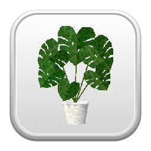
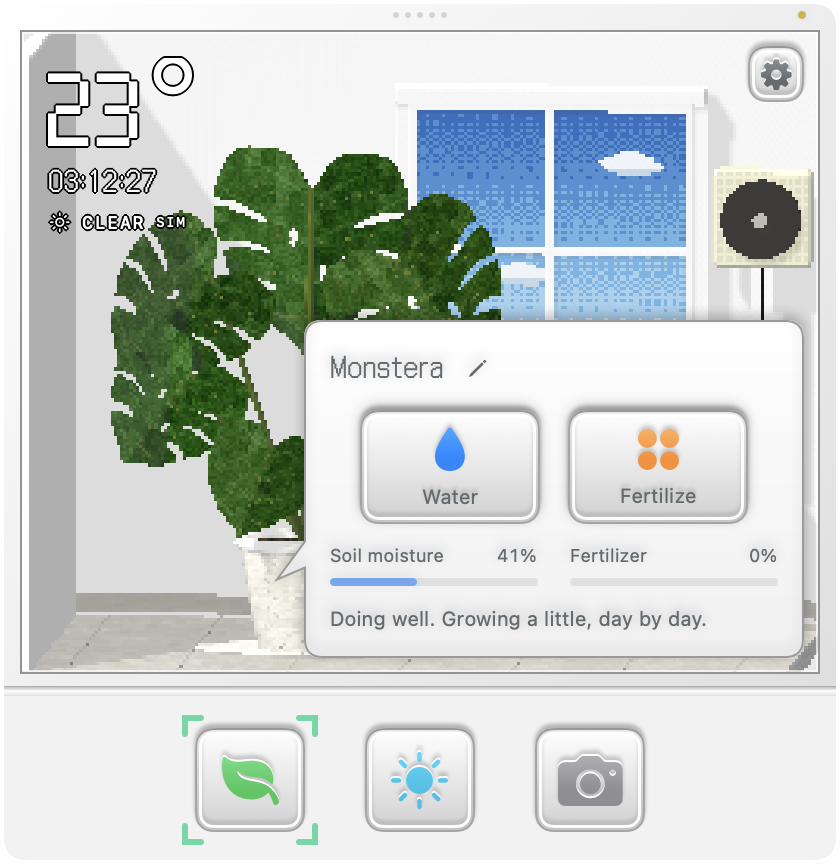
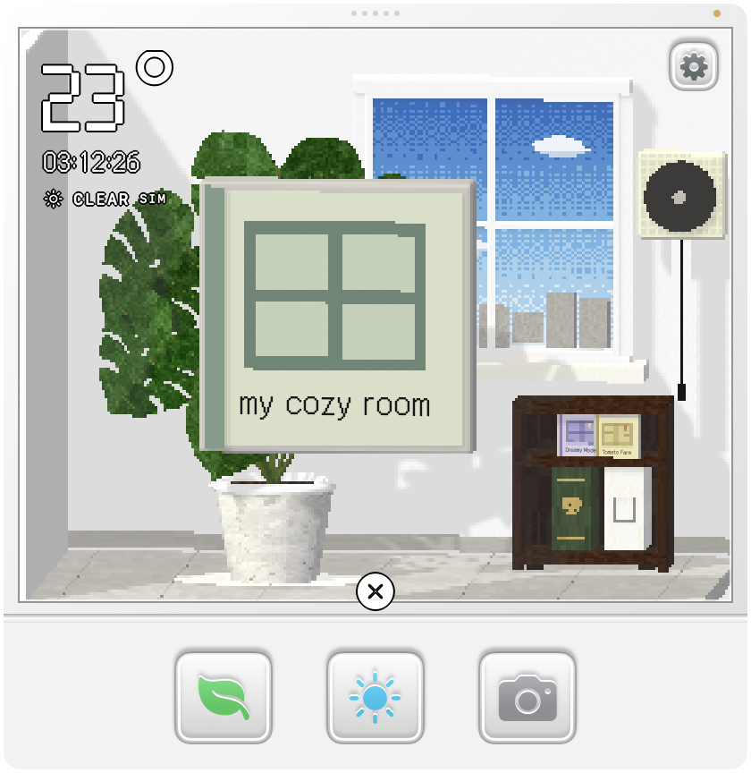
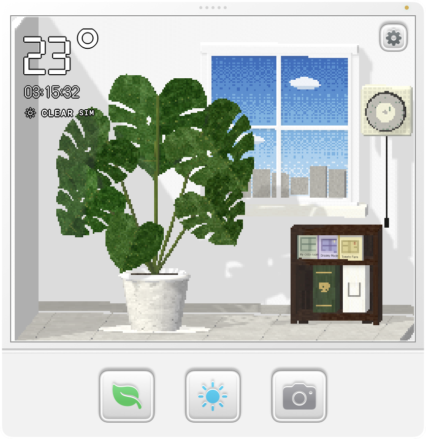
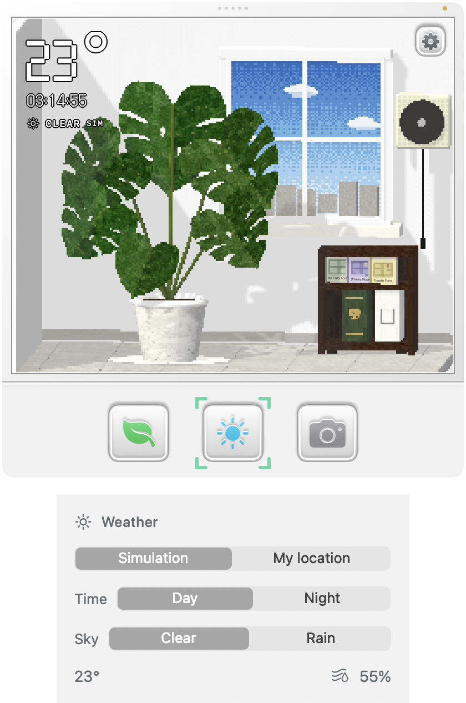
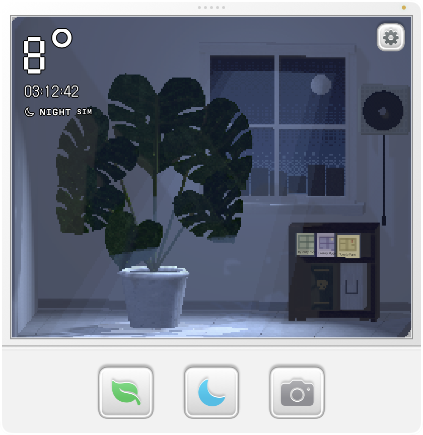
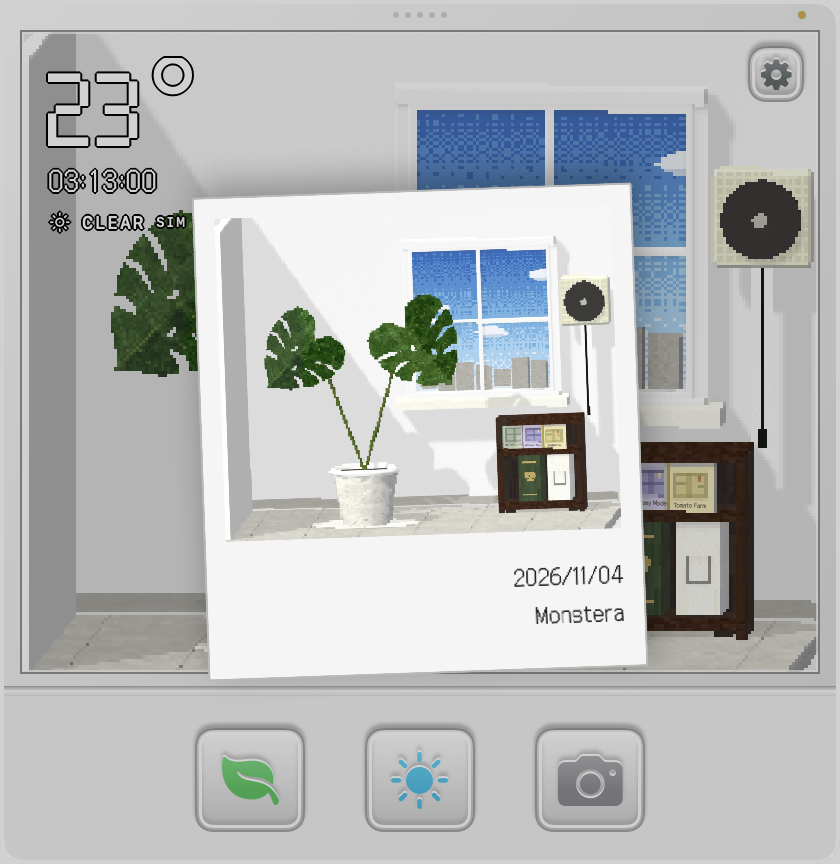
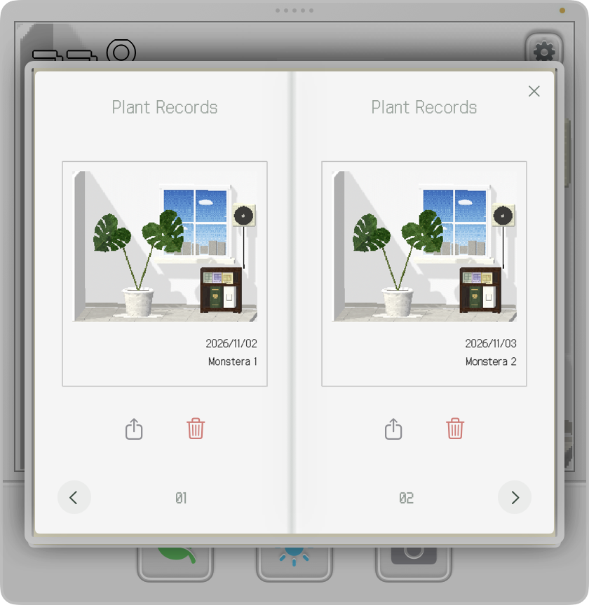

<p align="center">
  
</p>

# Little Plant

Grow a little plant inside your laptop, listen to lo-fi music, and take a moment to chill.

Add a little green to your MacBook’s menu bar. Put a lo-fi CD on the player, settle into your cozy room, and focus on your work while your Monstera grows beside you.

A native macOS app with rough, nostalgic 3D graphics and a handheld-console-inspired interface. Available in English and Korean.

## Install and launch

Requires **macOS 13 or later**. To build from source, install **Xcode Command Line Tools** with Swift 5.9 or later.

1. Download or clone this project.
2. Double-click **Run Little Plant.command** in Finder. The first launch builds the app and may take a few minutes.
3. Look for the **leaf icon in the menu bar**. Click it to open your room directly below the icon. Click it again, or click outside the room, to hide it.

You can also build and launch from Terminal:

```sh
./scripts/build-app.sh
open "dist/Little Plant.app"
```

After building, drag **dist/Little Plant.app** into **Applications** if you want to keep it there. Open that app for subsequent launches; you do not need to rebuild it each time. The app runs in the menu bar and does not appear in the Dock. Right-click the menu-bar leaf icon and choose **Quit Little Plant** to exit. You can also use **Settings → Quit**.

On first launch, macOS may ask to use your location for local weather. If you decline, the room uses virtual weather. No API key is required.

## Your little room

The three bottom buttons open **Care**, **Weather**, and **Camera**. Click the plant, window, books, and CD albums directly to interact with them. Hovering over an interactive object gives a small visual hint.

Use the gear button in the upper-right corner to change the language, adjust music and effects volume, toggle rain sounds, or quit.

The images below are actual captures of the running app in English, using isolated demonstration plants and photos. Your first plant starts with **two fully grown leaves**.

## Care for your plant



- **Open the care bubble:** click the plant or the bottom leaf button. It shows soil moisture, fertilizer concentration, and a short description of how your plant is doing.
- **Water:** wait until the soil is nearly dry. Choose **Water**, then click and drag the metal watering can to spray. Water must reach the soil to count. Release to stop, and press **Esc** or × to put the can away.
- **Ventilate:** click the window to open or close it. Open it after watering, then close it before a long, cold night.
- **Fertilize:** choose **Fertilize** to drop four pellets into the pot. Fertilizer helps new leaves grow faster; your plant does not need it to stay green. Avoid keeping the concentration at 100% for too long.
- **Trim:** when leaves turn yellow or dry out, use the scissors button and click the damaged leaf. Yellow leaves do not turn green again.
- **Grow:** keep water, daylight, and ventilation balanced. New leaves grow one at a time, up to six leaves. A new leaf takes about two days of good growing conditions at the base growth rate; fertilizer can speed this up.
- **Name your plant:** click the pencil beside its name in the care bubble.

The green **Plant Stories** book on the shelf contains a short care guide. These are simplified game rules, rather than horticultural advice.

## Play a lo-fi CD



1. Click a CD album on the shelf to bring its cover forward.
2. Click the album again to take out the CD.
3. Click the CD to send it gently into the wall-mounted player.
4. **Click the black pull cord** to start the music. The cord pulls down and the disc begins spinning. You do not need to drag it.
5. Click the cord again to pause. While stopped, click the disc in the player to return it to its album.



Choose from **my cozy room**, **Dreamy Mode**, and **Tomato Farm**. Return the current CD before loading another. Music and effects have separate volume controls in Settings.

## Set the weather and time of day



Click the bottom weather button. Select **Simulation**, then choose **Day** or **Night**, and **Clear** or **Rain** independently. All four combinations are available. This changes the room’s environment; the clock still shows your Mac’s current local time, and plant growth continues in real time.

Select **My location** to use local weather instead. If location or weather is unavailable, the app falls back to virtual weather.



Night brings blue moonlight into the room. Rain adds moving pixel rain and ambient rain sounds. Open the window to hear louder rain; turn rain sounds off in Settings whenever you prefer.

## Take and revisit photos



1. Click the bottom **camera button**. A flash captures the room at that moment and a Polaroid floats forward.
2. The picture leaves out the temperature, clock, and settings button. Its lower-right corner records the date and your plant’s name at the time of capture.
3. **Click the floating card to save it.** It flies into the white **Plant Records** book beside Plant Stories on the shelf.



- Click the white book, then its cover, to open the album. It is always on the shelf, even before your first photo.
- Use the page arrows to browse. Each page holds one card. Going back from the first spread closes the cover.
- Click a card to bring it forward and enlarge it. Click it again, or click outside it, to return to the album.
- Click the **gray share icon** below a card to copy the photo card to the clipboard. A brief confirmation appears; paste it into another app to share it.
- Click the **pale red trash icon** to delete a photo. Confirm **Yes** or **No** in the dialog, which includes the saved capture date.

Saved photos remain available after restarting the app. They are stored locally in `~/Library/Application Support/LittlePlant/PlantRecords/`.

## Project files

- `Sources/LittlePlant/` — native macOS interface, SceneKit room, audio, camera, and album.
- `Sources/PlantCore/` — plant growth and care rules.
- `Sources/LittlePlant/Resources/Fonts/` — bundled Nintendo DS BIOS and Galmuri14 fonts.
- `Sources/LittlePlant/Resources/Music/` — lo-fi CD tracks.
- `Sources/LittlePlant/Resources/Sounds/` — rain, page turns, and player effects.
- `Sources/LittlePlant/Resources/AppIcon.icns` — application icon built from the project’s 3D plant.
- `docs/images/` — the application icon preview and actual app screenshots used in this guide.
- `scripts/build-app.sh` — builds and packages `dist/Little Plant.app`.

Local weather is provided by [Open-Meteo](https://open-meteo.com/).
